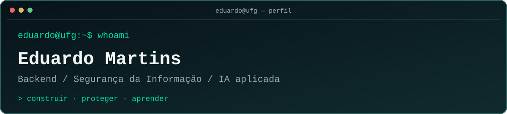

<div align="center">
  

  <a href="mailto:edrmartinss@gmail.com"></a>
  <a href="https://www.linkedin.com/in/eduardo-martins-258b5116a/"></a>
</div>

## `eduardo@ufg:~$ whoami`

```text
NOME       Eduardo Martins
BASE       Goiânia, Goiás · Brasil
FORMAÇÃO   Sistemas de Informação · UFG (em andamento)
ATUAÇÃO    Desenvolvimento backend · Segurança da Informação
INTERESSES GRC · Segurança ofensiva · IA aplicada
```

Desenvolvo soluções backend e automações, estudo segurança na prática e pesquiso aplicações de modelos de linguagem. Gosto de conectar engenharia de software, proteção de sistemas e análise de riscos.

## `eduardo@ufg:~$ cat atual.txt`

- **Backend e automação:** desenvolvimento em PHP e construção de integrações com Python, SQL e Linux.
- **Segurança e comunidade:** monitor na UrutauSec, liga acadêmica de cibersegurança da UFG, com estudos em White Team, gestão de identidades e segurança ofensiva.
- **Pesquisa em IA:** experiência em iniciação científica na UFG com LLMs para classificação de textos e extração de informações estruturadas.
- **GRC:** experiência em consultoria de segurança, avaliação de maturidade, gestão de riscos e privacidade, com ISO 27001, NIST CSF e LGPD.

## `eduardo@ufg:~$ ./stack.sh`

| Área | Tecnologias e temas |
|:--|:--|
| Desenvolvimento | PHP · Python · FastAPI · JavaScript · SQL |
| Infraestrutura | Linux · Docker · Git |
| Segurança | GRC · IAM · ISO 27001 · NIST CSF · LGPD · CTFs |
| IA | LLMs · Ollama · MCP · sistemas multiagente |

## `eduardo@ufg:~$ ls projetos/`

- **AssetGuard** — protótipo em FastAPI e SQLite para inventário de ativos de TI e gestão de acessos.
- **Hackbot Multiagente** — estudo em andamento sobre orquestração de LLMs locais e remotos, terminal e ferramentas MCP em fluxos de segurança.
- **Intelectualismo Negro** — aplicação web para a disciplina de Tópicos em Filosofia da UFG.
- **Pesquisa em NLP e LLMs** — extração de informações estruturadas de textos jornalísticos em iniciação científica na UFG.

## `eduardo@ufg:~$ cat certificacoes.txt`

```text
[+] Hacker Ético na Era da IA — IBSEC
[+] Analista de Cibersegurança (Governança) — IBSEC
[+] Certified GRC Professional (CGRCP) — Red Team Leaders
```

## `eduardo@ufg:~$ contact --open`

**[E-mail](mailto:edrmartinss@gmail.com)** · **[LinkedIn](https://www.linkedin.com/in/eduardo-martins-258b5116a/)**

---

<div align="center"><code>eduardo@ufg:~$ exit</code></div>
